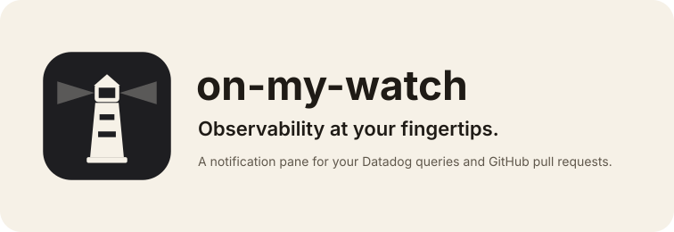
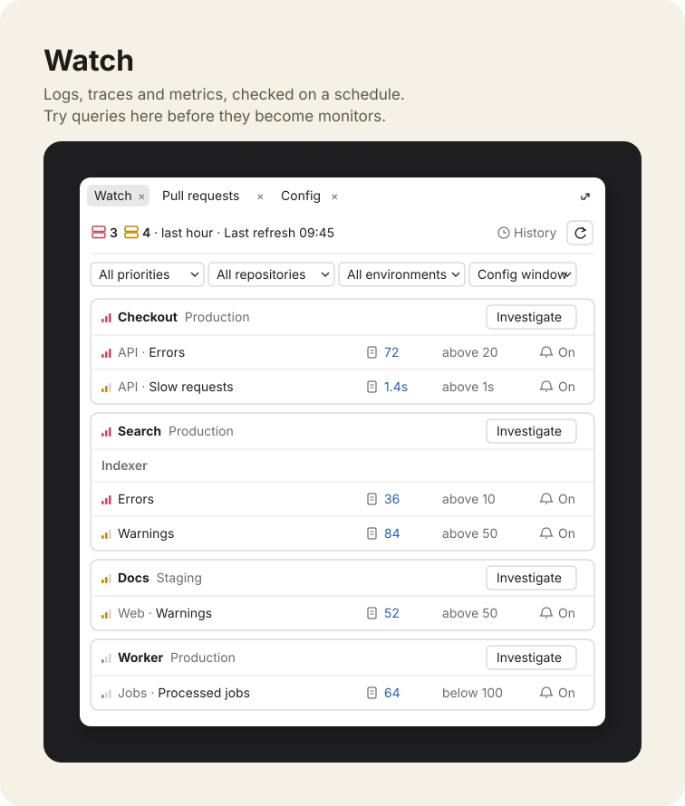
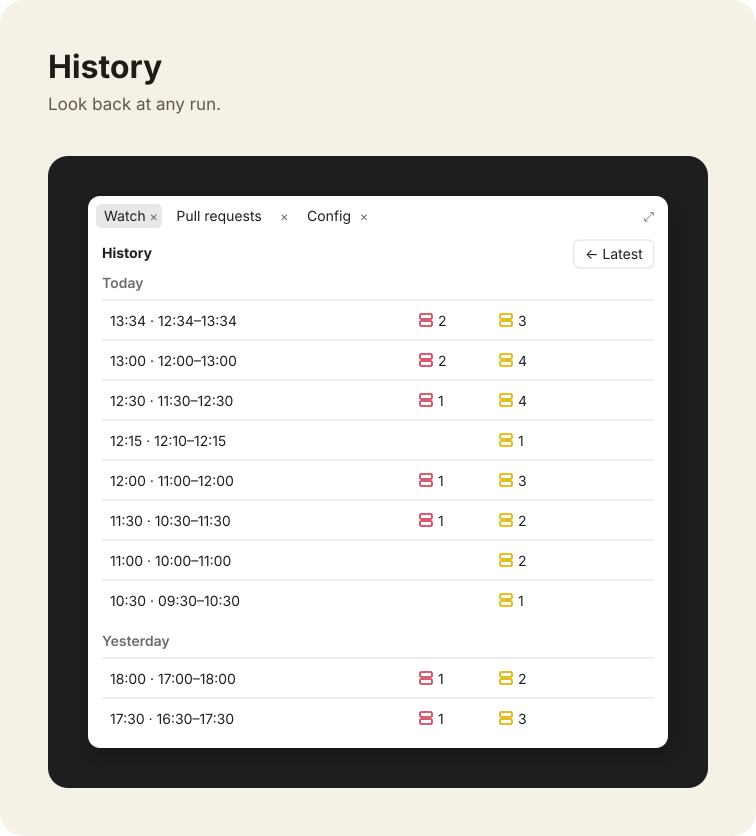
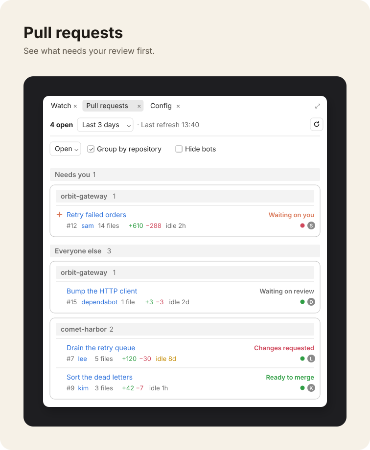
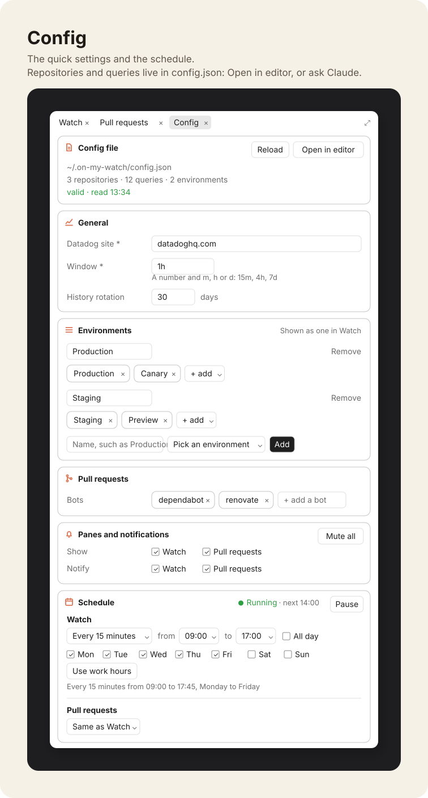

# on-my-watch



on-my-watch is a notification pane for Claude Code. It runs your queries, compares each value with the line you set, and tells you when one crosses it.

> [!WARNING]
> on-my-watch is still under development, and things might break. If something goes wrong or feels off, please [open an issue](https://github.com/imhalawa/on-my-watch/issues/new/choose). Every report helps. See [CONTRIBUTING.md](CONTRIBUTING.md) to help fix it.

## Features

- Alerts on your own Datadog queries over logs, traces and metrics.
- Every pull request on your repositories, with its CI status and reviews.
- Runs on a schedule, even with Claude Code closed.
- Desktop notifications on macOS, Linux and Windows. Mute them any time.
- Every run kept in History, 30 days by default.
- No Claude tokens until you press **Investigate** on a problem.

## Why

AI tools have made writing and shipping code faster than reviewing and watching it. A change can reach a shared environment and slowly make things worse, and the person who made it may not find out for a while.

Monitors are the right tool for failures you already know about. Each one has an owner, a threshold, alert routing and an on-call rotation behind it, which is why adding one takes care. Before that point there is usually a simpler question: what does this service look like right now, after my change? on-my-watch is for that question. It runs your own Datadog queries on a schedule, in a pane next to your work, and tells only you what it finds.

It does not replace monitoring:

- Nothing it finds pages anyone. Notifications go to your desktop and nowhere else.
- It reads Datadog with your own `pup` sign-in, so it sees only what you can already see.
- A query that keeps proving useful belongs in a monitor. One that doesn't can be changed or deleted without a review.

[architecture.md](architecture.md) explains how it works, why it costs no Claude tokens, and how Claude can help you set it up.

## Requirements

- macOS, Linux or Windows, with Python 3.
- [`pup`](https://github.com/DataDog/pup), the Datadog CLI, signed in with `pup auth login`. It runs your queries.
- [`gh`](https://cli.github.com), the GitHub CLI, signed in with `gh auth login`. It lists pull requests, CI status and reviews.
- On Linux, `notify-send` for notifications.

When a tool is missing or signed out, the pane says what to do.

## Quick start

1. Install the plugin:
   ```
   /plugin marketplace add imhalawa/on-my-watch
   /plugin install on-my-watch@on-my-watch
   ```
2. Run `/on-my-watch:configure` and answer its questions. It writes `~/.on-my-watch/config.json` for you. To write it by hand instead, copy [`config.example.json`](config.example.json) there.
3. Run `/watch`, then press ↻ in each pane.
4. Optional: run the checks on the config's schedule with `python3 <plugin folder>/bin/schedule.py install`. It uses launchd on macOS, your crontab on Linux and Task Scheduler on Windows. `uninstall` removes it.

## Panes

### Watch



- Each card is one repository in one environment, such as `Checkout · Production`. Its rows are grouped by service.
- A row is a query that crossed its alert line: priority, label, value and the line it crossed.
- The value links to the query in Datadog, pinned to the window that was checked.
- The most urgent card comes first.
- Dropdowns filter by priority, repository and environment.
- The window dropdown checks a different window at once. Scheduled runs keep the config's window.
- Each row can turn its own notifications off and on.
- **Investigate** sends a card's problems to Claude.

### History



- Past runs by day, with their problems per label.
- Reopen any run, with its links pinned to the window it checked.

### Pull requests



- Every pull request on your repositories, by any author.
- Filter by Open, Merged or Closed, over a span of up to a month.
- **Group by repository** or one list. **Hide bots** hides the accounts in `bots`.
- CI status and reviewers' pictures, with a check on those who approved.

### Config



- Edits the whole config in a form: settings, panes, notifications, repositories and queries.
- **Save changes** checks the config against the schema first and keeps the old file as `config.json.bak`.
- **Discard** drops your changes. **Reload** reads a config edited by hand.
- Schedule: a frequency with **Work hours only**, or a cron line. Set it for all queries or for one.
- Pause and resume scheduled runs. An installed schedule is updated to match.
- **Mute** silences every notification, scheduled ones included, until you unmute.

## Config

The config is a list of GitHub repositories. Each one holds the queries that watch its services:

```
config.json
├── repos: one per GitHub repository (owner/name)
│   ├── name: what the panes show, such as Checkout
│   ├── pull requests: every PR on the repository, by any author
│   └── queries
│       ├── service: groups the rows inside a card
│       ├── env: one card per repository and environment
│       └── label, query, alert line
└── environments: optional groups for Watch's filter
```

`repos` lists each repository by its GitHub `owner/name`, with the name you want to see and its queries. Each query names the service it watches. List a repository once, and within it use each combination of service, env and label once:

```json
"repos": [
  {
    "repo": "acme/checkout-api",
    "name": "Checkout",
    "queries": [
      { "service": "API", "label": "Errors", "env": "Production", "priority": 1, "source": "logs",
        "query": "service:checkout-api env:production status:error",
        "alert": { "above": 20 } }
    ]
  }
]
```

That entry reads `Checkout › API: Production - Errors`. Pull requests show once per repository, under its name. A repository with `"watch_only": true` is left out of Pull requests. A repository with no queries shows only there.

| Query field | Meaning |
|---|---|
| `service` | The service the query watches, as you want to see it. The pane groups rows by it. |
| `label` | What the query watches, such as Errors, Warnings or a name of your own |
| `env` | The environment the entry shows under. The query itself decides which data it reads. |
| `priority` | `1` (High, red), `2` (Medium, yellow) or `3` (Low, grey). Cards and rows sort by it. |
| `source` | `logs`, `traces` or `metrics` |
| `query` | The full Datadog query, run exactly as written |
| `alert` | `above`, `below` or both. Every condition given must hold. |
| `schedule` | Optional cron line for this query alone. Without it, the top-level `schedule` applies. |
| `compute` | For logs and traces. Default `count`, for example `percentile(@duration, 95)` |
| `reduce` | For metrics. Default `avg`; also `sum`, `max`, `min`, `last` |
| `notify` | `false` keeps the entry in the pane only |

Top-level fields:

| Field | Meaning |
|---|---|
| `site` | Your Datadog site, such as `datadoghq.com` |
| `schedule` | Cron line for the checks |
| `pullRequestsSchedule` | Optional cron line for pull requests. Without it, `schedule` applies. |
| `window` | How far back each check looks, for example `1h` |
| `repos` | The repositories and their queries, described above |
| `environments` | Optional groups that Watch's filter shows as one, such as `{ "Production": ["Production", "Canary"] }`. Each query keeps its own `env`. Watch's filter, the query form's Environment list and the Config counts all use it. |
| `panes` | `{ "watch": false }` or `{ "pull_requests": false }` turns a pane off |
| `historyDays` | How many days of runs to keep. 30 by default. |
| `bots` | The GitHub usernames that **Hide bots** hides. `["dependabot"]` by default. |
| `notify` | `{ "watch": true, "pull_requests": true }`. Sends one desktop notification for each new entry over its line, each open pull request whose CI turns red, and each time `pup` or `gh` needs you. It works from the schedule with Claude Code closed. |

[`config.schema.json`](config.schema.json) describes all of it. The checker refuses a config that breaks the schema and says where, so an unknown field, a missing label or a priority of 0 is caught before anything runs. `python3 bin/on_my_watch.py validate` checks yours. Point `$schema` at the file and your editor checks it as you type. See [`config.example.json`](config.example.json) for a full example.

## Files

Everything lives in `~/.on-my-watch/`: `config.json`, every run in `history.db` (SQLite), and `run.log` from scheduled runs.

## Development

```
python3 -B -m unittest discover -s tests
claude plugin test .
claude plugin validate .
```
