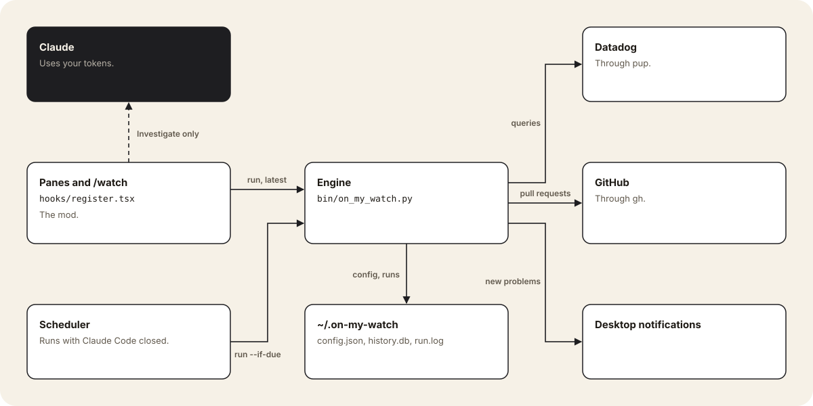
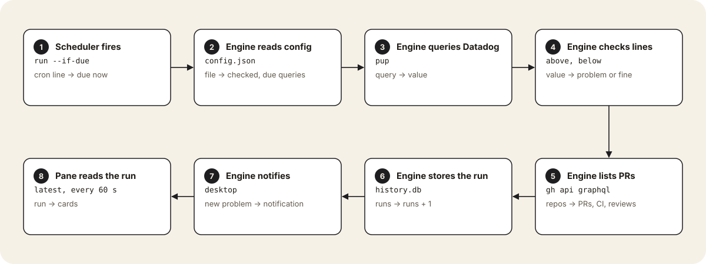
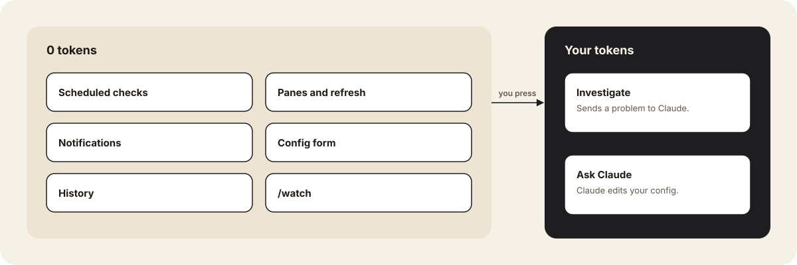
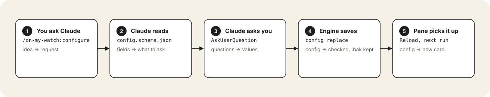

# Architecture

## Why

Code ships faster than anyone watches it. Monitors cover the failures you already know about, but each one needs an owner, a threshold and routing before it can exist. on-my-watch covers the step before that: your own queries, checked on a schedule, shown only to you. A query that proves useful becomes a monitor.

It is a notification pane and nothing more. Each check runs your query and compares the value with the `above` or `below` line you set. It has no anomaly detection and no logic of its own.

## Parts



| Part | File | Job |
|---|---|---|
| Mod | [`hooks/register.tsx`](hooks/register.tsx) | Draws the panes and `/watch`. Reads the latest run every 60 seconds. |
| Engine | [`bin/on_my_watch.py`](bin/on_my_watch.py) | Runs the checks, stores them and sends notifications. |
| Scheduler | [`bin/schedule.py`](bin/schedule.py) | Installs the cron line in launchd, crontab or Task Scheduler. |
| Data | `~/.on-my-watch/` | `config.json`, `history.db`, `run.log` |

The engine calls Datadog through `pup` and GitHub through `gh`, both with your own sign-in.

## A scheduled check



A config that breaks the schema stops at step 2, and the pane says where it breaks.

## Zero tokens



Checks, panes, notifications and the config form never call Claude. Only two things use your tokens:

- **Investigate** sends one problem, with its query and Datadog link, to Claude as a prompt.
- **Asking Claude** for help with the config is a normal conversation.

## Set it up with Claude



The [`configure`](skills/configure/SKILL.md) skill guides this. Run `/on-my-watch:configure`, or ask in plain words, for example:

```
Add a query to my on-my-watch config: error logs for checkout-api in production, priority 1, alert above 20.
```

Claude reads [`config.schema.json`](config.schema.json), asks for what it needs, and saves through the engine, which checks the config and keeps the old one as `config.json.bak`:

```bash
python3 bin/on_my_watch.py config replace < config.json
```

Press **Reload** in Config, or wait for the next run.
